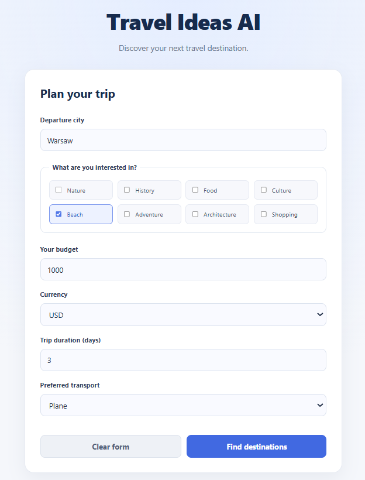
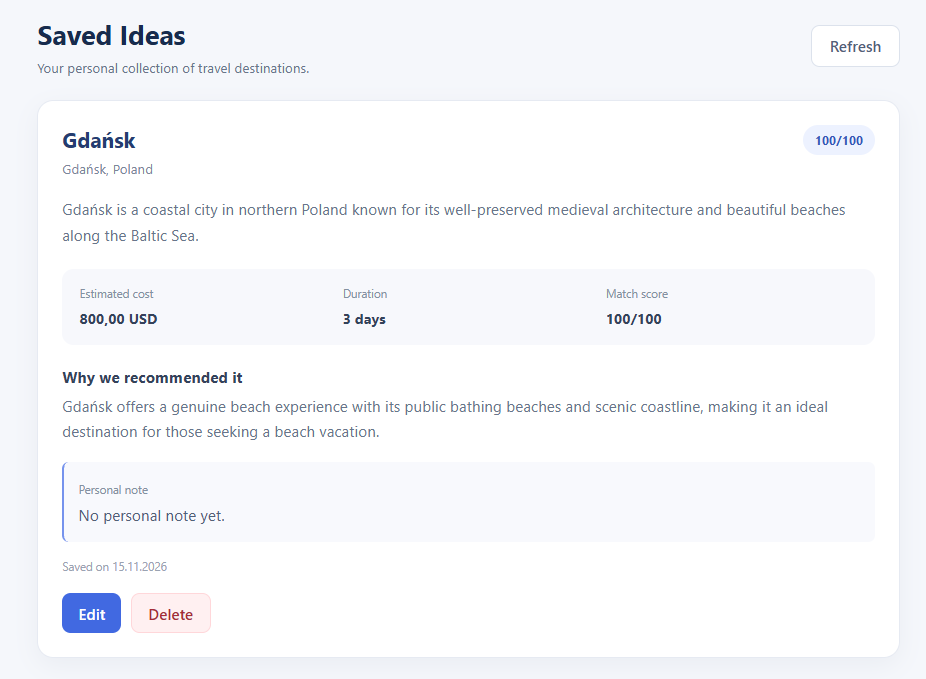
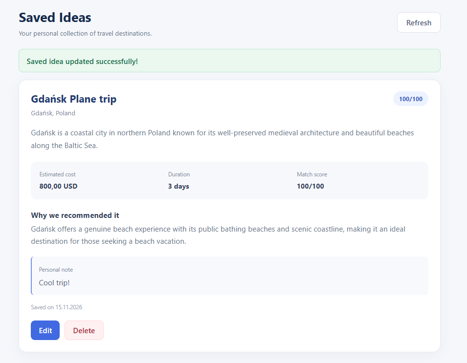
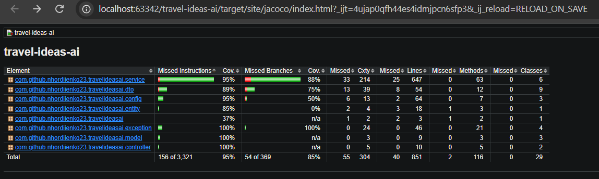

# Travel Ideas AI

**Discover your next travel destination.**

Travel Ideas AI is a full-stack web application that uses artificial intelligence to recommend travel destinations based on personal preferences, budget, trip duration, departure city, and preferred transportation.

The application generates three AI-powered travel recommendations, explains why each destination may be suitable, calculates a personalized Smart Trip Match score, and allows users to save and manage their favorite travel ideas.

## Features

### AI-Powered Travel Recommendations

- Enter your departure city.
- Select your interests:
  - Nature
  - History
  - Food
  - Culture
  - Beach
  - Adventure
  - Architecture
  - Shopping
- Set your travel budget and preferred currency (PLN, EUR, USD).
- Choose your trip duration (1–30 days).
- Select your preferred transportation (train, bus, car, or plane).
- Receive exactly three AI-generated destination recommendations.
- View destination descriptions, personalized explanations, estimated costs, and suggested trip durations.

### Smart Trip Match

Each recommendation receives a score from 0 to 100 points.

The score is calculated by the backend using three independent criteria:

| Criteria | Maximum score | Calculation |
|---|---:|---|
| Interest matching | 50 points | Based on the proportion of selected interests matched by the recommendation |
| Budget | 30 points | Awarded when the estimated trip cost does not exceed the user's budget |
| Duration | 20 points | Awarded when the suggested duration does not exceed the available trip duration |
| **Total** | **100 points** | Sum of all three criteria |

The score is calculated by the application, not by the AI model.

### Saved Travel Ideas

Users can manage their own collection of saved destinations:

- Save a recommendation.
- View all saved travel ideas.
- Edit a saved idea's title.
- Add or update a personal note.
- Delete saved ideas.

## Screenshots

The following screenshots demonstrate the main application features.
## Trip Planner

## AI Recommendations


## Saved Travel Ideas


## Editing a Saved Idea


## Demo

Watch a short demonstration of Travel Ideas AI, including AI-powered travel recommendations, Smart Trip Match scoring, and saved travel ideas management.

https://github.com/user-attachments/assets/ea66af0b-a81c-461a-b0c8-c4df258f753a
## Technology Stack

### Backend

- Java 25
- Spring Boot 4.1.2
- Spring Web MVC
- Spring Data JPA
- Hibernate
- H2 in-memory database
- Jakarta Bean Validation
- LangChain4j 1.23.0
- Ollama (`llama3.2:3b`)
- Lombok
- Maven

### Frontend

- React 19
- JavaScript
- Vite 8
- CSS
- Fetch API

### Testing and Code Coverage

- JUnit 5
- Mockito
- Spring Boot Test
- JaCoCo 0.8.16

## Architecture

The project follows a layered backend architecture with a clear separation between the frontend and backend.

### Recommendation Generation Flow

```text
React Frontend
      |
      v
POST /api/recommendations
      |
      v
RecommendationController
      |
      v
TravelRecommendationService
      |
      +--------------------------+
      |             |            |
      v             v            v
Travel          Destination   MatchScore
Recommendation  Country       Service
Assistant       Verifier
      |             |
      v             v
    Ollama       OpenStreetMap
    (LLM)        Nominatim
      |
      v
Validated AI Recommendations
      |
      v
Three Recommendation Cards
```

The recommendation generation flow is stateless and does not access the saved ideas repository.

### Saved Ideas Flow

```text
React Frontend
      |
      v
/api/ideas
      |
      v
SavedIdeaController
      |
      v
SavedIdeaService
      |
      v
SavedIdeaRepository
      |
      v
H2 In-Memory Database
```

The saved ideas functionality is independent of the AI recommendation generation logic.

### External Services

**Ollama** is used to generate travel recommendations locally using the `llama3.2:3b` model. LangChain4j integrates the language model with the Spring Boot backend.

Structured JSON output is requested using a JSON Schema. The backend validates the AI response before returning recommendations to the frontend.

**OpenStreetMap Nominatim** is used to check suggested destinations against geographical data, including city or town names and their countries. It also helps resolve canonical destination names.

## REST API

The backend exposes the following REST endpoints:

| Method | Endpoint | Description |
|---|---|---|
| POST | `/api/recommendations` | Generate three travel recommendations |
| POST | `/api/ideas` | Save a travel idea |
| GET | `/api/ideas` | Retrieve all saved ideas |
| PATCH | `/api/ideas/{id}` | Update a saved idea's title and personal note |
| DELETE | `/api/ideas/{id}` | Delete a saved idea |

### Example: Generate Recommendations

**POST** `/api/recommendations`

Request body:

```json
{
  "departureCity": "Warsaw",
  "interests": [
    "HISTORY",
    "FOOD",
    "CULTURE"
  ],
  "budget": 1500,
  "currency": "EUR",
  "durationDays": 7,
  "preferredTransport": "TRAIN"
}
```

The API validates the request, generates recommendations, validates destination information, and calculates Smart Trip Match scores.

## Project Structure

```text
travel-ideas-ai/
│
├── .github/
│   └── copilot-instructions.md
│
├── backend/
│   ├── src/
│   │   ├── main/
│   │   │   ├── java/
│   │   │   │   └── com/github/nhordiienko23/travelideasai/
│   │   │   │       ├── config/
│   │   │   │       ├── controller/
│   │   │   │       ├── dto/
│   │   │   │       ├── entity/
│   │   │   │       ├── exception/
│   │   │   │       ├── model/
│   │   │   │       ├── repository/
│   │   │   │       └── service/
│   │   │   └── resources/
│   │   │       └── application.yml
│   │   │
│   │   └── test/
│   │       └── java/
│   │
│   ├── mvnw
│   ├── mvnw.cmd
│   └── pom.xml
│
├── docs/
│   └── screenshots/
│       ├── 01-trip-planner.png
│       ├── 02-ai-recommendations.png
│       ├── 03-recommendations-details.png
│       ├── 04-saved-ideas.png
│       └── 05-edit-saved-idea.png
│
├── frontend/
│   ├── public/
│   ├── src/
│   │   ├── assets/
│   │   ├── components/
│   │   ├── services/
│   │   ├── utils/
│   │   ├── App.jsx
│   │   ├── App.css
│   │   └── index.css
│   │
│   ├── .env.example
│   ├── package.json
│   └── vite.config.js
│
├── IMPLEMENTATION_PLAN.md
├── README.md
└── .gitignore
```

## Getting Started

Follow these steps to run the application locally.

### Prerequisites

Make sure you have installed:

- **Java JDK 25**
- **Node.js and npm**
- **Ollama**

Maven does not need to be installed separately because the project includes the Maven Wrapper.

### 1. Clone the repository

```bash
git clone https://github.com/nhordiienko23/travel-ideas-ai.git
cd travel-ideas-ai
```

### 2. Set up Ollama

Install Ollama and download the model:

```bash
ollama pull llama3.2:3b
```

Make sure the Ollama service is running.

If it is not running as a background service, start it with:

```bash
ollama serve
```

By default, the backend connects to:

```text
http://localhost:11434
```

### 3. Run the Backend

Open a terminal in the project root and navigate to the backend directory:

```bash
cd backend
```

Start the Spring Boot application using the Maven Wrapper.

**Windows (PowerShell):**

```powershell
.\mvnw.cmd spring-boot:run
```

**macOS / Linux:**

```bash
./mvnw spring-boot:run
```

The backend will start at:

```text
http://localhost:8080
```

### 4. Run the Frontend

Open another terminal in the project root and navigate to the frontend directory:

```bash
cd frontend
```

Create your local environment file from the example:

**Windows (PowerShell):**

```powershell
Copy-Item .env.example .env
```

**macOS / Linux:**

```bash
cp .env.example .env
```

Install the dependencies:

```bash
npm install
```

Start the Vite development server:

```bash
npm run dev
```

The frontend will be available at:

```text
http://localhost:5173
```

You can now open the application in your browser.

## Configuration

The application uses environment variables for configurable service endpoints.

### Frontend

The `frontend/.env.example` file contains:

```env
VITE_API_BASE_URL=http://localhost:8080
```

### Backend

The backend configuration is stored in `backend/src/main/resources/application.yml`.

The following environment variables can be used to override the defaults:

| Variable | Default value | Description |
|---|---|---|
| `OLLAMA_BASE_URL` | `http://localhost:11434` | Ollama API endpoint |
| `OLLAMA_MODEL` | `llama3.2:3b` | Ollama model name |
| `NOMINATIM_BASE_URL` | `https://nominatim.openstreetmap.org` | Nominatim API endpoint |
| `NOMINATIM_USER_AGENT` | Project-specific User-Agent | User-Agent for Nominatim requests |

No external database configuration is required.

## Running Tests

The backend test suite contains **216 automated tests**.

The latest successful test run produced the following results:

| Result | Count |
|---|---:|
| Tests run | 216 |
| Passed | 216 |
| Failures | 0 |
| Errors | 0 |
| Skipped | 0 |

### JaCoCo Code Coverage

JaCoCo measures how much of the backend code is exercised by the automated tests.

The latest coverage report shows:

| Metric | Covered | Total | Coverage |
|---|---:|---:|---:|
| Instructions | 3,165 | 3,321 | **95%** |
| Branches | 315 | 369 | **85%** |
| Lines | 811 | 851 | **95%** |
| Methods | 114 | 116 | **98%** |
| Classes | 29 | 29 | **100%** |

The coverage report applies to the backend; it does not measure frontend code coverage.

### Running the Tests and Generating the Report

To run the backend test suite and generate the JaCoCo report:

**Windows (PowerShell):**

```powershell
cd backend
.\mvnw.cmd clean verify
```

**macOS / Linux:**

```bash
cd backend
./mvnw clean verify
```

The JaCoCo HTML report will be generated at:

```text
backend/target/site/jacoco/index.html
```

Open `index.html` in a browser to inspect instruction, branch, line, method, and class coverage.

The following screenshot shows the generated coverage report:

## JaCoCo test coverage report


To check the frontend code:

```bash
cd frontend
npm run lint
npm run build
```

## Important Notes and MVP Limitations

- AI-generated travel costs are approximate estimates. They are not live prices or guaranteed expenses.
- The application does not provide live flight, train, or bus schedules, booking functionality, or real-time transport availability.
- Nominatim is used for destination and country verification; it does not verify transport connections.
- Currency conversion is not performed. The selected currency is passed to the AI recommendation generation process.
- H2 is configured as an in-memory database. Saved ideas are removed when the backend application stops or restarts.
- The MVP does not include user authentication or separate user accounts.

## AI-Assisted Development

AI tools were used as development assistants during the implementation of this project.

- **ChatGPT** was used to discuss architectural decisions, refine AI prompt instructions, review implementation approaches, and identify test scenarios and edge cases.
- **GitHub Copilot** was used for coding assistance, implementation suggestions, boilerplate generation, and focused code improvements.

A project-specific `.github/copilot-instructions.md` file is included in the repository. It defines the project's technology stack, architectural principles, code quality expectations, testing conventions, and domain-specific rules.

AI-generated suggestions were reviewed and adapted to the existing project architecture and requirements.

## Author

**Mykyta Hordiienko**

GitHub: [nhordiienko23](https://github.com/nhordiienko23)
