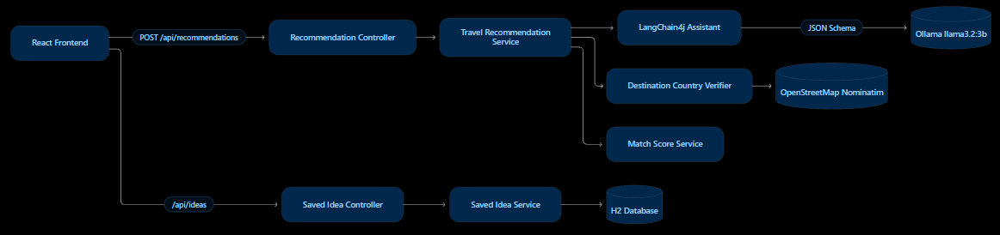
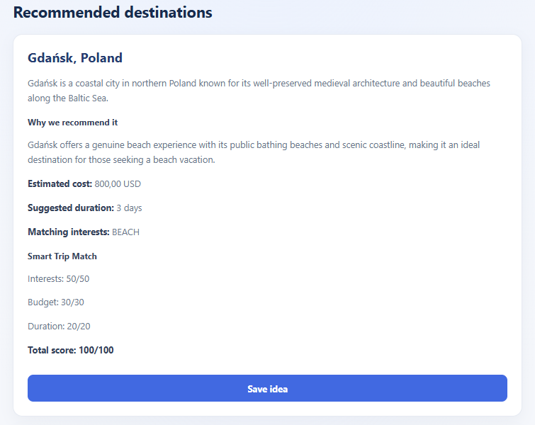

# Travel Ideas AI


A full-stack web application that recommends travel destinations using a local LLM based on personal interests, budget, trip duration, departure city, and preferred transport.

Built with **Java, Spring Boot, LangChain4j (Ollama), and React**, the backend generates three structured destination options, verifies real-world geography via **OpenStreetMap Nominatim**, calculates a deterministic **Smart Trip Match** score, and lets users save and annotate favorite ideas.

## Demo

https://github.com/user-attachments/assets/ea66af0b-a81c-461a-b0c8-c4df258f753a

## Features

- **AI-Powered Travel Recommendations:** Generates three tailored destinations based on departure city, interests (nature, history, food, culture, beach, adventure, architecture, shopping), budget (`USD`, `EUR`, `UAH`,`PLN`), trip duration (1–30 days), and transport mode (`train`, `bus`, `car`, `plane`)..
- **Deterministic Smart Trip Match (0–100 pts):** Backend-calculated score independent of the AI model:
  - **Interest matching (up to 50 pts):** Proportion of selected interests matched by the recommendation.
  - **Budget fit (30 pts):** Awarded when the estimated trip cost stays within budget.
  - **Duration fit (20 pts):** Awarded when the suggested duration fits the available trip days.
- **Destination Verification:** Cross-checks AI-suggested cities and countries against OpenStreetMap Nominatim to resolve canonical place names and filter invalid locations.
- **Saved Travel Ideas:** Save recommendations, browse saved destinations, edit titles, add personal notes, and delete items.

## Technology Stack

| Area | Technologies |
| --- | --- |
| Backend | Java 25, Spring Boot 4.1.2, Spring Web MVC, Spring Data JPA, Hibernate, Jakarta Bean Validation, Lombok |
| AI & External APIs | LangChain4j 1.23.0, Ollama (`llama3.2:3b`), OpenStreetMap Nominatim API |
| Frontend | React 19, JavaScript, Vite 8, CSS, Fetch API |
| Database & Build | H2 (in-memory), Maven (Wrapper), npm |
| Testing & Coverage | JUnit 5, Mockito, Spring Boot Test, JaCoCo 0.8.16 |

## Architecture


### Key Engineering Highlights

- **Structured LLM Output & Validation:** Requests strict JSON Schema output from Ollama through LangChain4j and validates every response field on the backend before returning results.
- **Hallucination Mitigation:** `DestinationCountryVerifier` checks AI-suggested cities and countries against OpenStreetMap Nominatim to normalize names and reject made-up locations.
- **Deterministic Scoring Over AI Guesses:** Rather than letting the LLM rate its own output, `MatchScoreService` computes the 100-point Smart Trip Match score in Java using explicit interest, budget, and duration rules.
- **Decoupled Application Flows:** Stateless recommendation generation is completely separated from saved-ideas CRUD persistence.

## Getting Started

### Prerequisites

- **Java JDK 25** (Maven Wrapper is included)
- **Node.js & npm**
- **Ollama**

### 1. Clone the repository

```bash
git clone [https://github.com/nhordiienko23/travel-ideas-ai.git](https://github.com/nhordiienko23/travel-ideas-ai.git)
cd travel-ideas-ai
```

### 2. Pull and start the local LLM

```bash
ollama pull llama3.2:3b
ollama serve
```

By default, Ollama runs on `http://localhost:11434`.

### 3. Start the backend

```bash
cd backend
./mvnw spring-boot:run        # macOS / Linux / Git Bash
# .\mvnw.cmd spring-boot:run  # Windows PowerShell
```

The API starts at `http://localhost:8080`.

### 4. Start the frontend

In a new terminal:

```bash
cd frontend
cp .env.example .env          # or Copy-Item .env.example .env in PowerShell
npm install
npm run dev
```

Open **[http://localhost:5173](http://localhost:5173)** in your browser.

### Configuration

Optional backend environment variables (defaults in `backend/src/main/resources/application.yml`):

| Variable | Default | Description |
| --- | --- | --- |
| `OLLAMA_BASE_URL` | `http://localhost:11434` | Ollama API endpoint |
| `OLLAMA_MODEL` | `llama3.2:3b` | Local LLM model name |
| `NOMINATIM_BASE_URL` | `https://nominatim.openstreetmap.org` | Nominatim geocoding endpoint |
| `NOMINATIM_USER_AGENT` | Project User-Agent | User-Agent header for Nominatim requests |

Frontend points to the backend via `VITE_API_BASE_URL=http://localhost:8080` in `frontend/.env`.

## Testing & Code Coverage

The backend includes **216 automated unit and integration tests** (`0` failures).

Run the test suite and generate the JaCoCo report:

```bash
cd backend
./mvnw clean verify           # .\mvnw.cmd clean verify in PowerShell
```

HTML report location: `backend/target/site/jacoco/index.html`

| Metric | Covered | Total | Coverage |
| --- | ---: | ---: | ---: |
| Instructions | 3,165 | 3,321 | **95%** |
| Branches | 315 | 369 | **85%** |
| Lines | 811 | 851 | **95%** |
| Methods | 114 | 116 | **98%** |
| Classes | 29 | 29 | **100%** |

Frontend checks:

```bash
cd frontend
npm run lint
npm run build
```

## REST API

| Method | Endpoint | Description |
| --- | --- | --- |
| `POST` | `/api/recommendations` | Generate three validated travel recommendations with match scores |
| `POST` | `/api/ideas` | Save a travel idea |
| `GET` | `/api/ideas` | List all saved ideas |
| `PATCH` | `/api/ideas/{id}` | Update a saved idea's title and personal note |
| `DELETE` | `/api/ideas/{id}` | Delete a saved idea |

<details>
<summary>Example request: <code>POST /api/recommendations</code></summary>

```json
{
  "departureCity": "Warsaw",
  "interests": ["HISTORY", "FOOD", "CULTURE"],
  "budget": 1500,
  "currency": "EUR",
  "durationDays": 7,
  "preferredTransport": "TRAIN"
}
```

</details>

## Project Structure

```text
travel-ideas-ai/
├── backend/                  # Spring Boot REST API, LangChain4j, Nominatim verifier, H2
├── frontend/                 # React + Vite SPA
├── docs/                     # Demo screenshots and JaCoCo coverage report
├── .github/                  # Project-specific Copilot instructions
└── IMPLEMENTATION_PLAN.md
```

## MVP Scope & Notes

- **Persistence:** Uses an H2 in-memory database for zero-config local setup; saved ideas reset on backend restart.
- **Cost Estimates:** Trip costs are LLM estimates in the selected currency (no live booking APIs, transport schedules, or currency conversion).
- **Single-User MVP:** Authentication and user accounts are outside the scope of this version.

## AI-Assisted Development

AI coding assistants (ChatGPT and GitHub Copilot) were used during development for architectural discussions, prompt refinement, boilerplate acceleration, and edge-case test ideas. Project conventions and quality rules are documented in `.github/copilot-instructions.md`, and all generated code was manually reviewed and tested.

## Screenshots

### Trip Planner


### AI Recommendations & Smart Trip Match


### Saved Travel Ideas


### Editing a Saved Idea


### JaCoCo Coverage Report


## Author
**Mykyta Hordiienko** — [GitHub](https://github.com/nhordiienko23)